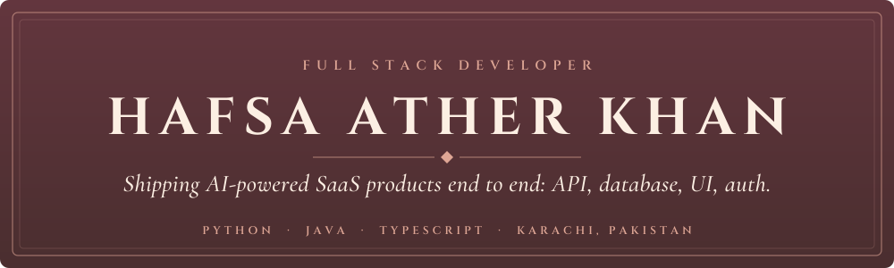

  
  
  
  

### 🧠 About Me

Full Stack Developer based in Karachi, Pakistan, currently pursuing a BS in Software Engineering at Sir Syed University of Engineering & Technology (CGPA 3.55/4.0).

- 🔭 Shipping full-stack products end to end: API → Database → UI → Auth
- 🤖 Exploring AI-integrated SaaS: Gemini API, prompt engineering, AI-assisted development
- 🔐 Drawn to backend architecture and auth systems: JWT, OTP, RBAC, sessions
- 🛡️ Learning cybersecurity fundamentals: CS50 Introduction to Cybersecurity *(in progress)*
- 🎯 Long-term goal: founding my own SaaS product

### 🛠️ Tech Stack

  
  
  
  
  
   
  
  
  
  
  
   
  
  
  
   
  
  
  
  
  
  
   
  
  
  
  
  
  

### 🚀 Featured Projects

<table>
<tr>
<td width="50%" valign="top">

**<a href="https://github.com/hafsaatherkhan/flyrank-capstone-metering-billing">⚡ HisaabLedger</a>: Usage Metering & Billing Engine** `FlyRank Capstone`
 `FastAPI · Next.js · TypeScript · PostgreSQL (Neon) · Polar.sh · Vercel`

Multi-tenant metering and billing engine. Idempotent writes (`Idempotency-Key`), row locking (`SELECT FOR UPDATE`) for strict monthly quotas under concurrent load, integer micro-USD pricing, Polar.sh webhook sync and reconciliation, and a live analytics dashboard (column, line, bar, pie). Auth is custom-built: dual JWT access/refresh tokens with rotation, Google ID-token verification, and OTP lockout with a resend cooldown.

</td>
<td width="50%" valign="top">

**<a href="https://github.com/hafsaatherkhan/NeXora">🌪️ NeXora</a>: Disaster & Civic Management System** `Team of 4`
 `React · Vite · Java 17 · Spring Boot · PostgreSQL · Redis · Gemini API`

Multi-role civic platform. My part: the authentication system (JWT access/refresh tokens, Redis, OTP with attempt lockout, email verification, password recovery) and the Worker Portal, with RBAC and Facade / Strategy / Factory / Null Object patterns applied in those modules.

</td>
</tr>
<tr>
<td width="50%" valign="top">

**<a href="https://github.com/hafsaatherkhan/Bawarchee">🍳 Bawarchee</a>: AI Pantry & Culinary Assistant** `Team of 3`
 `Next.js 14 · TypeScript · Supabase · PostgreSQL · Tailwind CSS · Gemini 2.5 Flash`

Pantry manager with Gemini-powered receipt OCR for inventory ingestion, household portion-scaled recipe generation, conversational culinary chat, and real-time inventory deduction. My part: authentication (Supabase Auth with TOTP 2FA), profile onboarding, and the initial version of the dashboard.

</td>
<td width="50%" valign="top">

**<a href="https://github.com/hafsaatherkhan/NeuralMail">✉️ NeuralMail</a>: AI-Powered Mail Generator** `Solo`
 `Flask · Tailwind CSS · JavaScript · SQLite · Gemini API`

Full-stack MVP that generates 3 AI email variations per request with the Gemini API. Session-based auth with persistent login, an email history dashboard, usage analytics, and SQLite locking issues resolved under simulated multi-user load.

</td>
</tr>
<tr>
<td width="50%" valign="top">

**<a href="https://github.com/hafsa-ather-khan/SkillmatriX">📊 SkillmatriX</a>: AI Career Platform** `🏆 2nd Position`
 `Next.js · TypeScript · Spring Boot · MySQL · Gemini API`

JWT-secured platform connecting a Next.js/TypeScript frontend to Spring Boot. Built OTP-based password recovery with expiry validation and retry-limit enforcement.

</td>
<td width="50%" valign="top">

**<a href="https://github.com/hafsaatherkhan/BolDo">🏠 BolDo</a>: Multi-Agent AI Home Services** `AISeekho 2026 Hackathon`
 `Flutter · Dart · Firestore · Multi-Agent Architecture · Gemini API`

Orchestrated a 6-agent AI workflow (Pricing, Booking, Notification, Follow-up, Dispute, Supervisor) in a hackathon sprint. Built the Pricing Agent for transparent dynamic pricing.

</td>
</tr>
<tr>
<td colspan="2" valign="top">

**<a href="https://github.com/hafsa-ather-khan/LagunaBreezeLodge">🏨 Laguna Breeze Lodge</a>: Desktop Hotel Booking System** `🥈 2nd Position · Semester Project`
 `Java · JavaFX · SQLite`

Role-based hotel booking system (Admin / User / Guest) built as a team semester project. Owned the backend and auth system end to end: full RBAC login/registration, the Admin Portal (user management, booking history), and about 80% of the database schema and logic, plus integration of the backend with the JavaFX UI.

</td>
</tr>
</table>

### 📈 GitHub Stats

### 🎓 Education & Certifications

- **BS Software Engineering**, Sir Syed University of Engineering & Technology · Oct 2024 – Jul 2028 · CGPA 3.55/4.0
- **Generative and Agentic AI Application Developer Certificate**, Pak Angels · Cohort 11, Aug – Oct 2026 · Top Performer · Issued Oct 17, 2026 · ID: PAGAI-TP-1560
- **Anthropic: 11 course certifications** (Jul – Oct 2026)
  - Claude 101 · Claude Code 101 · Introduction to Claude Cowork
  - AI Capabilities and Limitations
  - AI Fluency: Framework & Foundations
  - AI Fluency for Students · Small Businesses · Nonprofits · Educators · Builders
  - Teaching AI Fluency

### 🏆 Hackathons & Extracurriculars

**Leadership**
- **Digital Operations Team Lead**, Google Developer Groups on Campus, SSUET *(Nov 2025 – Oct 2026)*
- **Graphic Design Team Member**, IEEE SSUET Student Branch *(Aug 2025 – Nov 2025)*

**Hackathons**
- **AI Hackathon, Devmarketplace**: [Bawarchee](https://github.com/hafsaatherkhan/Bawarchee)
  - AI-powered kitchen assistant (Next.js, TypeScript, Supabase, Gemini API). Team of 3.
  - My part: authentication, TOTP two-factor authentication, profile onboarding, and the initial version of the dashboard.
- **PAK ANGELS Hackathon (course-based)**: [OfficeFlow AI](https://github.com/hafsaatherkhan/OfficeFlowAI) · [Live demo](https://office-flow-ai.vercel.app/)
  - Multi-agent office helpdesk (Next.js, TypeScript, Prisma, PostgreSQL, Gemini API). Team project.
  - My part: project foundation, database schema and seed data, server-side Gemini integration, and the tool registry.
- **AISeekho 2026 Hackathon, GDG**: [BolDo](https://github.com/hafsaatherkhan/BolDo)
  - Multi-agent home service orchestrator (Firebase).
- **Women Tech Quest'26 – Build With AI, 10 Pearls Pakistan**: Bill Decoder
  - AI-powered utility bill decoder (CLI app).
- **ELXR'26 Hackathon, KSBL Entrepreneurship Society**: Pak Stock AI
  - Warehouse management prototype.
- **National AI Hackathon 2026, atomcamp**: BasiraBlue
  - Emergency management prototype.

### 📫 Let's Connect

