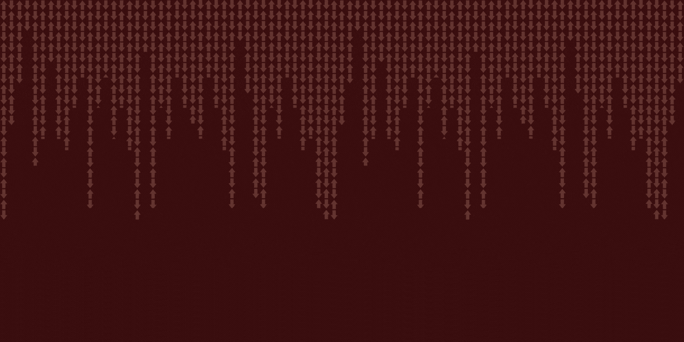

<!-- ====================================================== -->
<!--                    HEADER BANNER                       -->
<!-- ====================================================== -->

  

# HAFSA ATHER KHAN

### Backend AI Engineering | Software Engineering Student

*I bring secure thinking, full-stack craft, and a creative eye together to make digital experiences that matter.*

  
  
  

---

<!-- ====================================================== -->
<!--                       ABOUT ME                         -->
<!-- ====================================================== -->

## 01 / About Me

I'm a Software Engineering student interested in building intelligent, scalable and secure software systems.

My work focuses on backend engineering, AI-powered applications, SaaS architecture and practical problem-solving.

- 🎓 Pursuing BS Software Engineering at SSUET.
- ⚙️ Interested in backend systems and API architecture.
- 🤖 Exploring Generative AI and agentic systems.
- 🔐 Building my foundations in cybersecurity.
- 🧩 Interested in turning complex ideas into usable products.
- 🌱 Continuously learning, experimenting and building.

---

<!-- ====================================================== -->
<!--                    TECHNICAL ARSENAL                    -->
<!-- ====================================================== -->

## 02 / Technical Arsenal

**Languages**

  

**Backend & Frameworks**

  

**Databases & Infrastructure**

  

**AI, Tools & Development**

  

**Currently Exploring**

  
  
  
  

---

<!-- ====================================================== -->
<!--                    FEATURED PROJECTS                   -->
<!-- ====================================================== -->

## 03 / Featured Projects

### MomentRa — Personal Operating System

A personal operating system designed to help users organize their time, goals and different areas of life.

- Built around Time Vault and Worlds.
- Designed to bring personal organization into one cohesive experience.
- **Stack:** MERN

### NeuralMail — AI-Powered SaaS Email Platform

An AI-powered email platform focused on contextual email generation and management.

- Integrated Gemini 2.5 Flash.
- Developed backend workflows using Flask and REST APIs.
- Implemented session-based authentication.
- Migrated persistence from SQLite to Neon PostgreSQL.

**Stack:** Flask · Python · Gemini · SQLite · Neon PostgreSQL

### Bawarchee AI

An AI-powered application built with a modern full-stack architecture.

- Integrated Gemini for AI-powered functionality.
- Built with Supabase-backed application infrastructure.

**Stack:** Next.js · TypeScript · Supabase · Gemini

### OfficeFlow AI

An AI-powered workflow application built around an orchestrator-worker architecture.

- Designed an orchestrated workflow structure.
- Integrated AI-powered processing.
- Used Prisma and Neon for database operations.

**Stack:** Next.js · TypeScript · Prisma · Neon PostgreSQL · Gemini

### LLM Usage Metering & Billing Service

A backend capstone project developed during the FlyRank AI internship.

- Built an LLM usage metering and billing service.
- Focused on backend usage tracking and billing workflows.

**Stack:** Backend Engineering · LLM Integration · Usage Metering

[View Capstone Repository](https://github.com/hafsaatherkhan/flyrank-capstone-metering-billing)

---

<!-- ====================================================== -->
<!--                   GITHUB STATISTICS                    -->
<!-- ====================================================== -->

## 04 / GitHub Statistics

### Developer Overview

### Contribution Streak

---

<!-- ====================================================== -->
<!--                    CODING METRICS                      -->
<!-- ====================================================== -->

## 05 / Coding Metrics & Insights

<!-- This image will be generated by GitHub Metrics Actions -->

---

<!-- ====================================================== -->
<!--                  CONTRIBUTION ACTIVITY                 -->
<!-- ====================================================== -->

## 06 / Contribution Activity

---

<!-- ====================================================== -->
<!--                   GITHUB ACHIEVEMENTS                  -->
<!-- ====================================================== -->

## 07 / GitHub Achievements

---

<!-- ====================================================== -->
<!--                 EXPERIENCE & EDUCATION                 -->
<!-- ====================================================== -->

## 08 / Experience & Education

**FlyRank AI — Back-End AI Engineering Intern**

July – November 2026

- Completed the AI internship program.
- Developed an LLM Usage Metering & Billing Service as a capstone project.

**Sir Syed University of Engineering & Technology**

BS Software Engineering | 2024 – 2028

**Community & Professional Activities**

- Google Developer Groups On Campus — SSUET, Digital Operations Team Lead.
- IEEE SSUET Student Branch — Graphics Team Member.

---

<!-- ====================================================== -->
<!--                        CONNECT                         -->
<!-- ====================================================== -->

## 09 / Let's Connect

I'm always interested in connecting with developers, exploring ideas and learning through meaningful technical collaboration.

  
  

<!-- ====================================================== -->
<!--                     FOOTER BANNER                      -->
<!-- ====================================================== -->

  

